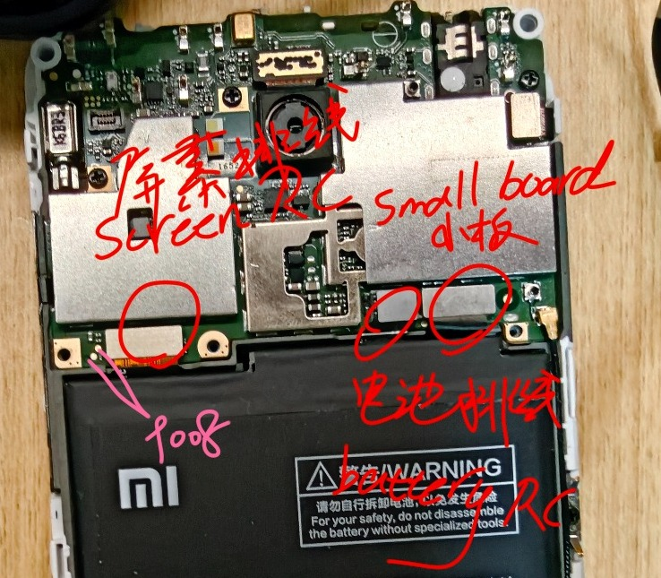

> 📦 **Release 下载提示**：请前往对应的 GitLab 仓库查看或下载 Release（GitHub 端暂不重复上传）👉 [https://gitlab.com/xusu616/markw-recovery-bypass/-/releases](https://gitlab.com/xusu616/markw-recovery-bypass/-/releases) （[GitLab 仓库主页](https://gitlab.com/xusu616/markw-recovery-bypass)）

# Redmi 4 Prime / markw：9008 引导绕过与 TWRP 安装记录

[English](README.en.md)

**English version may not have this**



官方解锁服务器关了，所以是9008的方案

这台手机屏蔽了9008线所以只能拆机

稍后传个test引脚图

当然我现在很懒

所以README甚至都是ai写的（（

其他要注意的（？：

需要把指纹和后盖扣回再重启才有指纹

然后就是kernelsu最多用0.9.5的，否则不会支持，如果版本对了还不支持就下个更低版本的kernelSu然后覆盖安装，应该就能扫到了

**Eng have those below the comment**

2026-11-12 ~ 2026-11-13 实测 Redmi 4 Prime（红米 4 高配版，代号 `markw`，Snapdragon 625 / MSM8953），原系统 MIUI 8（`V8.2.1.0` 系列 `aboot`）。

这是锁定 bootloader 下的**启动验证绕过，不是正式解锁**；`aboot` 与 `abootbak` 使用官方未修改的 Xiaomi 签名镜像，未获得设备专属解锁签名，`fastboot` 写入限制依然存在。

## 仓库简明用法（备份 → 刷入 → 刷 ROM → 回滚）

仓库中 `payloads/` 已保存通用的 `V8.0.5.0` `aboot`、`misc` 与 XML 配置；运行过程中生成的本机原厂备份位于 `local-only/markw-diagnosis-20261112/`（已在 `.gitignore` 忽略，含 `gpt-primary.bin`、`aboot.bin`、`abootbak.bin`、`devinfo.bin`、`recovery-original.bin` 等），建议另存本地或私密备份，不要上传到公开仓库

1. **备份原机分区（9008 模式）**：断电池短接进入 9008 后运行 `python .\scripts\wait_and_dump_markw_gpt.py`，读取 GPT 并备份上述本机原始分区到 `local-only/markw-diagnosis-20261112/`
2. **预处理尾块**：对需要引导的 TWRP 镜像运行 `python .\scripts\append-boot-footer.py <原镜像> <带尾块镜像>`，在页对齐结尾追加 4096 字节特定尾块
3. **刷入绕过用 `aboot` 与初始 TWRP（9008 模式）**：运行 `python .\scripts\flash_markw_miui8_aboot_and_twrp.py` 一次性写入 `V8.0.5.0` `aboot`、`abootbak`、带尾块 Cofface TWRP 与 `misc`，完成后拔线扣回电池并单按电源键即可进入 TWRP（未刷第三方 ROM 前不要重启回原厂 MIUI）
4. **切换 TWRP 与刷入 ROM**：若刷 Android 11~14 Treble ROM，先在当前 TWRP 下把带尾块的高版本 TWRP（如 `twrp_3.7.0_12-1-markw_by_SonicBSV_18_11_2023-appended.img`）写入 `recovery` 并 `adb reboot recovery` 切换，再 `Format Data`、清理 `cache`/`dalvik`/`system` 后刷入 ROM ZIP；**重启前**务必从 ROM ZIP 提取 `boot.img`，跑一次 `append-boot-footer.py` 生成带尾块版本并写回 `boot` 分区，同时确认 `misc` 为全零后再重启（后续刷 Magisk 或换内核也需重新补尾块）
5. **回滚原厂引导（9008 模式）**：保持 `local-only/markw-diagnosis-20261112/` 备份完整，进 9008 运行 `python .\scripts\restore_markw_original_aboot.py` 即可还原出厂签名 `aboot` 与 `abootbak`（如需一并还原官方 Recovery，可再手动写回 `recovery-original.bin`）

## 已验证的组合与原理

| 部件 | 本次使用的文件 | 状态 |
| --- | --- | --- |
| `aboot` / `abootbak` | MIUI 8 `V8.0.5.0.MBECNDG` 原始小米签名 MBN（尾部补零到 1 MiB） | 已通过 9008 刷入并验证启动 |
| 初始 recovery | `cofface_twrp_recovery_markw_1121-appended.img`（追加 4096 字节尾块） | 已成功启动至 TWRP（ADB root 正常） |
| Treble recovery | `twrp_3.7.0_12-1-markw_by_SonicBSV_18_11_2023-appended.img`（追加 4096 字节尾块） | 已刷入并正常启动至 TWRP 3.7.0 |
| 引导触发辅助 | `misc-boot-recovery-512B.bin`（写入 `boot-recovery\0` 到 `misc` 分区） | 已实测直接进 TWRP，启动后已清零 |
| 通用尾块脚本 | `scripts/append-boot-footer.py` | 已用于生成带尾块 recovery 与 ROM `boot.img` |
| 已实测 ROM | `crDroidAndroid-14.0-20240803-markw-v10.6.zip`（Android 14，内核 `4.9.337`） | 已刷入并正常开机（默认未启用 FBE 加密，内核集成 `CONFIG_KSU=y`） |
| Root 管理器 | `KernelSU_v0.9.5_11872-release.apk`（`me.weishu.kernelsu`） | 覆盖安装后已正常识别内建 KernelSU |

在 Android `boot` / `recovery` v0 镜像有效数据段页对齐结尾追加 4096 字节（前 5 字节 `30 83 19 89 64`，其余为零）后，原机 `V8.2.1.0` `aboot` 无法正常启动；换用官方未修改签名的 `MIUI V8.0.5.0.MBECNDG` `aboot` 后，实测可正常引导带尾块镜像。

任何 ROM 安装、换内核或 Magisk 修补 `boot.img` 若重新打包镜像，都会丢失尾块。正确顺序：**完成所有 `boot` 修补 → 检查镜像 → 追加尾块 → 写入 `boot` 分区 → 重启**。

## 目录和来源

本地仓库：`D:\Project\markw-recovery-bypass`

```text
README.md / README.en.md  中文与英文指南
LICENSE                   MIT 许可证
scripts/                  9008 备份/烧录与尾块处理脚本
payloads/                 V8.0.5.0 aboot、misc 触发镜像、rawprogram XML
roms/                     markw TWRP 与待刷 ROM（二进制默认不提交）
tools/                    emmcdl 2.16、MSM8953 Firehose（二进制默认不提交）
docs/                     诊断与 ROM 选型记录
local-only/               本机原始备份与日志，不提交
SHA256SUMS.txt            工具及镜像校验值
```

技术细节见 [BOOTLOADER-DIAGNOSIS.md](docs/BOOTLOADER-DIAGNOSIS.md)，ROM 候选说明见 [ROM-SELECTION.md](docs/ROM-SELECTION.md)。

## 1. EDL 布局与原始备份

Redmi 4 Prime（`markw` / MSM8953，512 字节扇区）关键分区 GPT 偏移（来自本机 `01-read-gpt.log`）：

| 分区 | 起始 LBA | 扇区数 | 大小 |
| --- | ---: | ---: | ---: |
| `aboot` | 786432 | 2048 | 1 MiB |
| `abootbak` | 788480 | 2048 | 1 MiB |
| `boot` | 790528 | 131072 | 64 MiB |
| `recovery` | 921600 | 131072 | 64 MiB |
| `devinfo` | 1052672 | 2048 | 1 MiB |
| `misc` | 8060928 | 2048 | 1 MiB |
| `cust` | 8651792 | 1048576 | 512 MiB |

只读诊断与备份脚本：

```powershell
Set-Location D:\Project\markw-recovery-bypass
python .\scripts\wait_and_dump_markw_gpt.py
```

原始 `gpt-primary.bin`、`aboot.bin`、`abootbak.bin`、`devinfo.bin`、`recovery-original.bin` 均已保存在 `local-only/markw-diagnosis-20261112/`。

## 2. 离线生成与校验镜像

```powershell
python .\scripts\prepare-images.py aboot .\payloads\emmc_appsboot-miui8-v8050-original.mbn .\payloads\aboot-miui8-v8050-signed-1MiB.bin
python .\scripts\append-boot-footer.py .\roms\cofface_twrp_recovery_markw_1121.img .\roms\cofface_twrp_recovery_markw_1121-appended.img
python .\scripts\prepare-images.py misc .\payloads\misc-boot-recovery-512B.bin
```

输出已存在时脚本会拒绝覆盖。

## 3. EDL 单次原子写入 `aboot` + `TWRP` + `misc`

在单个 `emmcdl` XML 会话中连续写入 `aboot`、`abootbak`、`recovery` 与 `misc`：

```powershell
# 首次全量写入（aboot + abootbak + recovery + misc）：
python .\scripts\flash_markw_miui8_aboot_and_twrp.py

# 若 aboot 已为 V8.0.5.0，仅重刷 TWRP 与 misc：
python .\scripts\flash_markw_miui8_aboot_and_twrp.py --twrp-only
```

烧录完成后：
1. 拔掉 USB 数据线，扣紧电池排线；
2. 无需按音量组合键，直接按一次电源键开机即可直接进入 Cofface TWRP；
3. 进入 TWRP 后检查 `misc` 是否已清零（本版本 TWRP 启动时会自动清零；若未清零，执行 `adb shell "dd if=/dev/zero of=/dev/block/bootdevice/by-name/misc bs=512 count=1"`）。

注意：**不要在未刷自定义 ROM 前重启进原版 MIUI**，否则 MIUI 开机脚本会将 `recovery` 还原为官方版。

## 4. 刷入 ROM 与保留尾块

1. 按 [ROM-SELECTION.md](docs/ROM-SELECTION.md) 选择 Non-Treble 或 Treble ROM；若刷入 Android 11~14 Treble ROM，可先在当前 Cofface TWRP 下将已补尾块的 `twrp_3.7.0_12-1-markw_by_SonicBSV_18_11_2023-appended.img` 写入 `/dev/block/bootdevice/by-name/recovery`，随后执行 `adb reboot recovery` 切换到新版 TWRP。
2. 若从出厂 MIUI 8（FDE 加密）跨版本升级到 Android 14，需先在 TWRP 执行一次 `Format Data`（`twrp format data`）并清理 `cache`、`dalvik`、`system`，再推送并安装 ROM ZIP。
3. **重启前**，从 ROM ZIP 提取 `boot.img`，生成带尾块版本并写入 `boot` 分区：
   ```powershell
   python .\scripts\append-boot-footer.py .\roms\<rom-boot-original>.img .\roms\<rom-boot-appended>.img
   adb push .\roms\<rom-boot-appended>.img /tmp/boot-appended.img
   adb shell "sha256sum /tmp/boot-appended.img"
   adb shell "dd if=/tmp/boot-appended.img of=/dev/block/bootdevice/by-name/boot bs=512"
   adb shell sync
   ```
4. 确认 `misc` 分区保持全零且 `boot` 写回无误后，再执行 `adb reboot`。

## 相关下载链接

以下链接均为本次实际测试期间核对过的资源地址，按用途分类记录：

- **SonicBSV `markw` 维护目录（AndroidFileHost）**：  
  [AndroidFileHost (flid=339504)](https://androidfilehost.com/?w=files&flid=339504)
- **Treble TWRP（Android 11 ~ 14）**：
  - `twrp_3.7.0_12-1-markw_by_SonicBSV_18_11_2023.img`：[fid=16385555061192795609](https://androidfilehost.com/?fid=16385555061192795609)
  - `twrp_3.7.0_12-1-markw_by_SonicBSV.img`：[fid=4279422670115717343](https://androidfilehost.com/?fid=4279422670115717343)
- **已验证 / 同系列 ROM 包**：
  - `crDroidAndroid-14.0-20240803-markw-v10.6.zip`（Android 14，本次已刷入开机）：[fid=6586087556536863991](https://androidfilehost.com/?fid=6586087556536863991)
  - `crDroidAndroid-13.0-20231128-markw-v9.11.zip`（Android 13）：[fid=16385555061192797663](https://androidfilehost.com/?fid=16385555061192797663)
- **KernelSU 管理器**：
  - `KernelSU v0.9.5`（`KernelSU_v0.9.5_11872-release.apk`，官方主线最后支持非 GKI 4.x 内核的版本；配合上述内核内建的官方签名 `CONFIG_KSU=y` 使用）：[GitHub Releases v0.9.5](https://github.com/tiann/KernelSU/releases/tag/v0.9.5)
- **其他历史 ROM / 备选来源**：见 [ROM-SELECTION.md](docs/ROM-SELECTION.md)（包含 Xiaomi.eu MIUI 10.2、LineageOS、Havoc-OS、Pixel Experience Plus 等来源说明）。

## 关键 SHA-256

| 文件 | SHA-256 |
| --- | --- |
| `payloads/emmc_appsboot-miui8-v8050-original.mbn` | `ba0294d98ddb7d16b3df16b7c5bae0807550e06cbe28babe0cb6fad487e281a3` |
| `payloads/aboot-miui8-v8050-signed-1MiB.bin` | `cff1766fc4e6d3db7a9a0b17d24019e09856aeed029fb43a94982bca7d7a60cc` |
| `payloads/misc-boot-recovery-512B.bin` | `9418492e5b413376d2927de020eecc19a0be271687c4edb6437b7ce7268a2171` |
| `roms/cofface_twrp_recovery_markw_1121.img` | `6599cbbda6b7d2510e8caa8ac2817e49cc6fb7403c877e3d08ddd28ce7af701e` |
| `roms/cofface_twrp_recovery_markw_1121-appended.img` | `dfd363b80ea169621230ab33fefa049d60b99036e757cad35374cc2b7c9b3218` |
| `roms/twrp_3.7.0_12-1-markw_by_SonicBSV_18_11_2023.img` | `d28e68061ef87e2cdc66070d8cd175712f3e0faba341df965775bfc917372a00` |
| `roms/twrp_3.7.0_12-1-markw_by_SonicBSV_18_11_2023-appended.img` | `c0e79809e637e863a5cf8e818b0b8aba725f2fa41711ee1b33aa72536061e630` |
| `tools/emmcdl-2.16.exe` | `24540d815142a3d63c4bf4a01fd4db0c0aefb26794749d65480ce0a9f2bc83bb` |
| `tools/prog_emmc_firehose_8953_ddr.mbn` | `8e7c2f3c6ad93eb1383b1f9d476d18466c32adde13c3e8b5c46e4ceeea40a6a4` |

## 故障与回退

- **恢复原厂签名引导**：确保 `local-only/markw-diagnosis-20261112/` 下的 `aboot.bin` 与 `abootbak.bin` 备份完整，在 9008 模式下运行：
  ```powershell
  python .\scripts\restore_markw_original_aboot.py
  ```
- **900E / 无法开机**：断开电池排线数秒后重新扣回电池并尝试开机或重进 9008 核对分区内容。
